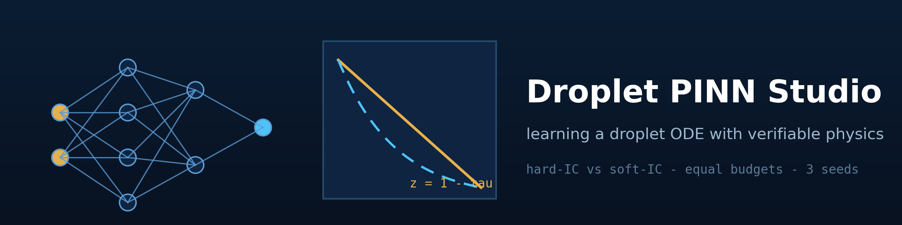
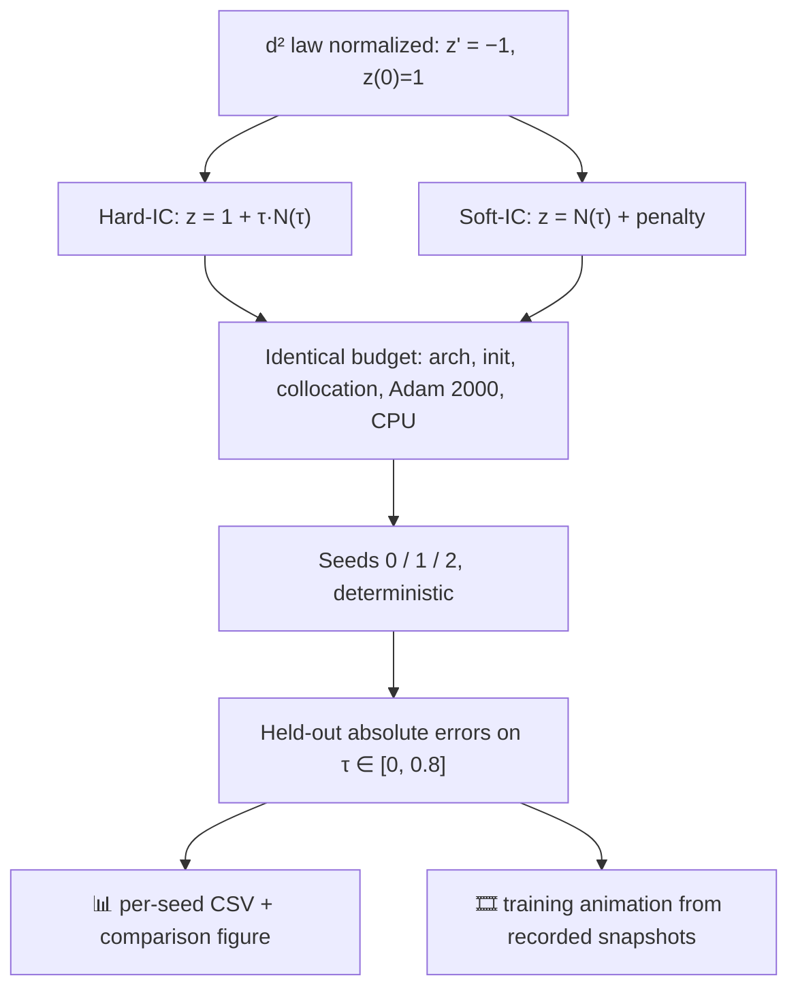

<div align="center">



# 🎓 Droplet PINN Studio

### Learning a droplet ODE with verifiable physics

**An original CPU-PINN study of the normalized constant-condition d² law
(z′ = −1, z(0) = 1, exact z = 1 − τ): hard-IC ansatz vs soft-IC network under
identical budgets, three deterministic seeds, held-out absolute errors, and a
training animation built from recorded optimizer snapshots.**

[](https://github.com/khalil-work/droplet-pinn-studio/actions/workflows/ci.yml)
[](LICENSE)
[](requirements.txt)
[](tests)
[](requirements-dev.txt)
[](https://github.com/khalil-work/droplet-pinn-studio/stargazers)
[](https://github.com/khalil-work/droplet-pinn-studio/commits)

[Quick start](#-quick-start) · [Study design](#-problem-formulations-measurement) · [Animation](#%EF%B8%8F-results-gallery) · [Verification](#%EF%B8%8F-verification) · [References](#-references)

</div>

---

## 🎯 Purpose and scope

A clean, honest PINN study on a problem with a **free exact solution**: how should the
initial condition be handled — built into the ansatz (z = 1 + τ·N(τ)) or penalized in
the loss? Equal budgets, controlled seeds, absolute held-out metrics.

> **This is an illustrative droplet submodel:** no atomization, no spray CFD, no
> experimental agreement, and no superiority claims over the (free) analytic solution.

| | |
| --- | --- |
| 🧠 **Question** | Hard-IC (structural) vs soft-IC (penalty) initial-condition handling |
| ⚖️ **Control** | Identical architecture, init, collocation points, optimizer, steps, CPU |
| 🎲 **Seeds** | Three deterministic seeds (0/1/2), bitwise reproducibility tested |
| 📏 **Metrics** | Absolute held-out max/L2 on τ ∈ [0, 0.8] — never relative (z → 0 at τ = 1) |
| 🎞️ **Evidence** | 6 tests, per-seed CSV, training animation from recorded snapshots |

## 🧮 Problem, formulations, measurement

| Element | Setting |
| --- | --- |
| Normalized law | z = q/q₀, τ = K t/q₀ ⇒ dz/dτ = −1, z(0) = 1, z_exact = 1 − τ |
| Hard-IC | z = 1 + τ·N(τ) — IC structural |
| Soft-IC | z = N(τ) + IC penalty term in the loss |
| Network | 1→20→20→1 tanh, Xavier init, 40 collocation points |
| Optimizer | Adam 2000 steps with mid-budget LR halving, CPU |
| Loss | mean((dz/dτ + 1)²) via autograd (+ penalty for soft-IC) |

### The study pipeline



Full method: [docs/model.md](docs/model.md) · API: [docs/api.md](docs/api.md)

## ⚡ Quick start

```bash
python -m pip install -r requirements-dev.txt   # CPU torch included
python -m pytest tests -q                       # 6 verification tests
python examples/run_verification.py             # study + figures + GIF
```

<details>
<summary><b>📦 Verified environments</b></summary>

Python 3.13.5, torch 2.14.1+cpu, NumPy 2.1.3, Windows 11; CI installs CPU torch on
Ubuntu. Tests ≈ 18 s; the study ≈ 1 min.

</details>

<details>
<summary><b>🧱 Repository layout & API example</b></summary>

```
droplet_pinn_studio/
└── studio.py          # exact_solution, make_network, hard_ansatz, train_pin
tests/test_studio.py   # 6 verification tests
examples/run_verification.py   # equal-budget study + animation
docs/ model.md  api.md  verification.md  results/
```

```python
from droplet_pinn_studio import train_pin

result = train_pin(formulation="hard", seed=0, steps=2000)
print(result["held_out_max_abs_error"])   # ~7.7e-5
```

</details>

## ✅ Verification

Six tests: structural-IC identity, exact-solution consistency via autograd, loss
reduction on both formulations, soft-IC actually needing its penalty, bitwise seed
reproducibility, and absolute-metric/interval conventions. Evidence and limits:
[docs/verification.md](docs/verification.md).

## ⚠️ Limitations

- One deliberately trivial ODE; no transfer claim to PDEs or stiff systems.
- Equal steps ≠ equal FLOPs; CPU only.
- Windows torch+MKL duplicate-OpenMP quirk handled in the results script
  (`KMP_DUPLICATE_LIB_OK`, documented).
- No spray/atomization/experimental scope anywhere.

---

## 🎞️ Results gallery

<div align="center">

**▶ Watch the network learn the law:**


<sub>40 recorded optimizer snapshots (hard-IC ansatz, seed 0, 2000 Adam steps) with
the exact curve and the current step count visible — every frame is an actual network
prediction, no decorative transitions.</sub>

</div>

### 📈 Results (held-out max |error|, 3 seeds)

| Formulation | seed 0 | seed 1 | seed 2 | mean | std |
| --- | --- | --- | --- | --- | --- |
| hard-IC ansatz | 7.7e-5 | 8.1e-5 | 2.3e-4 | **~1.3e-4** | ~7e-5 |
| soft-IC network | 7.5e-4 | 5.9e-5 | 1.3e-3 | ~7.2e-4 | ~5e-4 |

Measured on this budget: the hard-IC ansatz gives a lower mean error and clearly
lower seed variability — the structural IC removes a failure mode the penalty term
only suppresses. One small problem; not a general claim.

### 🖼️ Static figures & raw data

- [comparison.png](docs/results/comparison.png) — formulation comparison across seeds
- Raw data: `summary.csv`, `best_run_profile.csv`, `run_summary.json` in
  [docs/results/](docs/results)

## 📚 References

- M. Raissi, P. Perdikaris, G. E. Karniadakis, "Physics-informed neural networks"
  (PINN framing, by title).
- Guo et al., "Discrete lattice effects…" (droplet-forcing context out of scope;
  droplet d² law via classical texts as in Droplet Journey).
- S. Wang, X. Yu, P. Perdikaris, "When and why PINNs fail to train" —
  hard-constraint context.

Dependencies: PyTorch (BSD-style), NumPy (BSD-3), Matplotlib (PSF-based),
Pillow (HPND), pytest (MIT). This repository's own code is original and
MIT-licensed; see [LICENSE](LICENSE).

History metadata: [documented calendar records](docs/CALENDAR_HISTORY.md).
